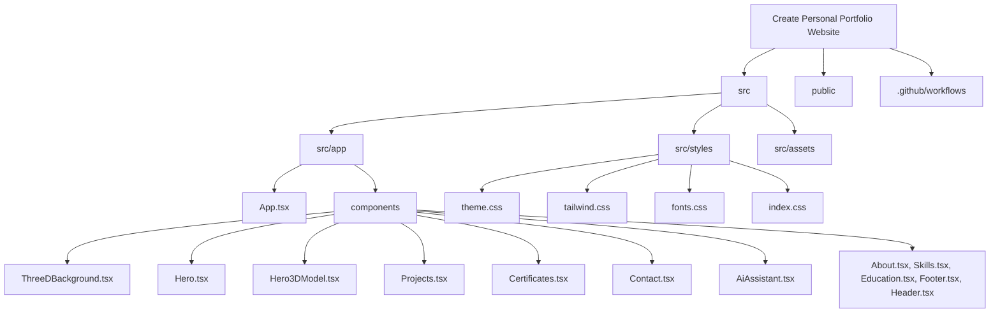

# Somil Portfolio Neural Engine Brain Dump (`brain.md`)

This document serves as the persistent source of truth, technical spec, and progress report for the **Somil Mittal Personal Portfolio Website**. It outlines the project's architecture, design tokens, component breakdown, active integrations, deployment workflows, and current progress. Use this file to avoid redundant analysis and preserve codebase context.

---

## 🌌 Project Overview
- **Owner / Profile:** Somil Mittal — BCA (AI & ML) Student, AI/ML developer, and tech enthusiast based in Jaipur, India.
- **Theme Concept:** "Neural Engine Activated" — A premium, high-fidelity, interactive 3D/cyberpunk portfolio with dark-mode optimizations, glowing glassmorphism elements, neon color schemes, and micro-interactions.
- **Workspace Root:** [Create Personal Portfolio Website](file:///c:/Users/sanum/Downloads/Create%20Personal%20Portfolio%20Website)

---

## 🛠️ Technology Stack & Dependencies

The project is built using a modern, performant, and visual-first web stack:

### 1. Core & Build System
- **Framework:** React 18+ & TypeScript
- **Bundler / Build Tool:** [Vite v6](file:///c:/Users/sanum/Downloads/Create%20Personal%20Portfolio%20Website/vite.config.ts) (configured with `@vitejs/plugin-react`)
- **Package Manager:** NPM / PNPM (overrides in place for Vite version consistency)

### 2. Styling & Layout
- **CSS Engine:** Tailwind CSS v4 (using `@tailwindcss/vite` integration)
- **Theme Definition:** [src/styles/theme.css](file:///c:/Users/sanum/Downloads/Create%20Personal%20Portfolio%20Website/src/styles/theme.css) containing:
  - Custom Tailwind v4 `@theme inline` mappings.
  - Dark-mode custom variant configuration (`@custom-variant dark (&:is(.dark *))`).
  - HSL and hex system design tokens (Deep Void background, Electric Purple glows, and Neon Green/Lime accents).
  - Modern fonts setup (Headline: *Sora*, Body: *Plus Jakarta Sans*, Labels/Caps: *Space Grotesk*).

### 3. Animation & Interactions
- **Framing & Transitions:** `motion` (Framer Motion v12, using `motion/react`)
- **Utility CSS Animations:** `tw-animate-css`
- **Dynamic Feedback:** `canvas-confetti` (used upon successful contact form submissions)
- **Icons:** `lucide-react`

---

## 📂 Codebase Directory & File Structure

### Key Configuration Files:
- [package.json](file:///c:/Users/sanum/Downloads/Create%20Personal%20Portfolio%20Website/package.json) — Core dependencies, scripts (`dev`, `build`), and package overrides.
- [tsconfig.json](file:///c:/Users/sanum/Downloads/Create%20Personal%20Portfolio%20Website/tsconfig.json) — TypeScript compiler configurations.
- [vite.config.ts](file:///c:/Users/sanum/Downloads/Create%20Personal%20Portfolio%20Website/vite.config.ts) — Configures React plugin and Tailwind v4 compilation.
- [index.html](file:///c:/Users/sanum/Downloads/Create%20Personal%20Portfolio%20Website/index.html) — Main entry point containing SEO tags, custom fonts loader, theme restoration script (safeguards against dark/light mode flashes), and site verification tags.
- [public/robots.txt](file:///c:/Users/sanum/Downloads/Create%20Personal%20Portfolio%20Website/public/robots.txt) — Directives for search crawlers.
- [public/sitemap.xml](file:///c:/Users/sanum/Downloads/Create%20Personal%20Portfolio%20Website/public/sitemap.xml) — XML Sitemap for indexing search engine optimization.

---

## 🎨 Design System & Aesthetic Tokens

The visual style is configured inside [theme.css](file:///c:/Users/sanum/Downloads/Create%20Personal%20Portfolio%20Website/src/styles/theme.css) and uses custom color mappings:

| Token Name | HEX Code / Value | CSS Variable | Visual Application |
| :--- | :--- | :--- | :--- |
| **Deep Void** | `#020617` | `--deep-void` | Core website background (Dark mode) |
| **Electric Purple** | `#8B5CF6` | `--electric-purple` | Glows, ambient lights, highlights |
| **Primary Container** | `#c3f400` | `--primary-container` | Neon lime/green highlights & primary action buttons |
| **Secondary Container** | `#ff4a8d` | `--secondary-container` | Neon pink/magenta badges & highlights |
| **Tertiary Fixed Dim**| `#00daf3` | `--tertiary-fixed-dim` | Neon cyan badges & interactive accents |
| **Surface Dim** | `#0b1326` | `--surface-dim` | Card container background (Dark mode) |
| **Glass White** | `rgba(255,255,255, 0.1)` | `--glass-white` | Glassmorphism borders and overlay panels |

---

## 🧩 Detailed Component Analysis

### 1. Main Wrapper & Global Controls
- **[App.tsx](file:///c:/Users/sanum/Downloads/Create%20Personal%20Portfolio%20Website/src/app/App.tsx):** Assemblies all sections (Hero, About, Skills, Projects, Education, Certificates, Contact, Footer) inside a relative container. Renders the `<ThreeDBackground />` fixed behind everything and mounts the Sonner `<Toaster />` for global message notifications.

### 2. Interactive Background
- **[ThreeDBackground.tsx](file:///c:/Users/sanum/Downloads/Create%20Personal%20Portfolio%20Website/src/app/components/ThreeDBackground.tsx):** Uses HTML5 Canvas context (`2d`) for a magnetic dot-grid system:
  - Draws a dense spacing grid representing neural synapses.
  - Distorts grid coordinates in real-time based on mouse positioning (applies repulsion/attraction fields).
  - Renders glowing shooting stars crossing the canvas at timed intervals.
  - Dynamically updates color values based on current active CSS variables (dark vs. light theme colors).

### 3. Header & Navigation
- **[Header.tsx](file:///c:/Users/sanum/Downloads/Create%20Personal%20Portfolio%20Website/src/app/components/Header.tsx):** 
  - Sticky glassmorphism header with active link highlighting using scroll detection.
  - Features the brand logo "Somil Mittal" styled with neon drop shadow gradients.
  - Implements theme toggle (defaults to dark mode, saves state to `localStorage`, and updates `document.documentElement` `.dark` class).
  - Mobile responsive dashboard drawer navigation menu with active hover indicators.

### 4. Hero Section & Interactive 3D Model Composition
- **[Hero.tsx](file:///c:/Users/sanum/Downloads/Create%20Personal%20Portfolio%20Website/src/app/components/Hero.tsx) & [Hero3DModel.tsx](file:///c:/Users/sanum/Downloads/Create%20Personal%20Portfolio%20Website/src/app/components/Hero3DModel.tsx):**
  - Clean, realistic headline: *"Hi, I'm Somil Mittal"* with subtext *"AI & Machine Learning Developer · Poornima University"*.
  - Restored the **Original 3D Model Composition** upgraded with interactive physics:
    - **Central 3D Holographic Brain:** Floating neural brain model with circuit network, floating physics (`float-animation`), and interactive mouse-tracking 3D parallax depth.
    - **Floating Code Panel (Top Left):** 3D-angled glass panel displaying real Python neural architecture code (`optimize_neural_path()`), colorful window dots, and multi-layer depth offset (`translateZ(80px)`).
    - **Floating Data Wave Panel (Bottom Right):** 3D-angled glass panel displaying holographic real-time telemetry wave charts.
    - **3D Developer Avatar (Bottom Left):** 3D vinyl developer with VR goggles floating in the foreground.
    - **Ambient Lighting:** Dual-layer purple and lime ambient glow fields pulsing softly behind the 3D scene.
  - Handles resume PDF download, redirection to projects, and contact forms.
  - Connects social links to GitHub and LinkedIn.

### 5. Skills
- **[Skills.tsx](file:///c:/Users/sanum/Downloads/Create%20Personal%20Portfolio%20Website/src/app/components/Skills.tsx):**
  - Integrated authentic official vector logos from **[TechLogos.tsx](file:///c:/Users/sanum/Downloads/Create%20Personal%20Portfolio%20Website/src/app/components/TechLogos.tsx)** replacing generic Lucide outline icons.
  - Technical skills (Python, C Language, HTML/CSS/JS, AI & Machine Learning, Computer Vision & OpenCV, Full-Stack Architecture) render official high-fidelity brand SVGs alongside animated progress bars.
  - Tools & Technologies (VS Code, Git & GitHub, Flutter, OpenCV / PyTorch, Figma, Canva) render official brand emblems within neutral, high-contrast surface containers with interactive hover scale micro-interactions.
  - Neutral badge styling ensures vibrant brand colors (Python blue/yellow, C blue, React cyan, Figma 5-color, Git orange) look crisp and punchy in both Light Mode and Dark Mode.

### 6. Projects Showcase
- **[Projects.tsx](file:///c:/Users/sanum/Downloads/Create%20Personal%20Portfolio%20Website/src/app/components/Projects.tsx):**
  - Titled **"Featured Projects"** (renamed from "Mechanical Modules" with realistic, human-centered subtitle).
  - Modern horizontal carousel rendering high-fidelity project displays with crisp local screenshot assets (`code_connect.png`, `face_recognition.png`, `laundry_system.png`, `finance_tracker.png`).
  - Removed robotic/sci-fi elements (`STREAM_ACTIVE`, `STATUS: ACTIVE`, `STATUS: SYNCED`, hardware screws, `PROJECT_01`, and 15° isometric rotation skew).
  - Clean preview frames with realistic badges (`🏆 1st Place GDG Hackathon`, `👁️ Computer Vision & AI`, `📊 Database & Billing System`, `⚡ Full-Stack SaaS & Stripe`).
  - 100% visible in both light mode and dark mode with high-contrast text, visible borders, and responsive action buttons (`Live Demo`, `Source`).
  - Projects listed:
    1. *Code Connect* (GDG Hackathon 1st Place) — Collaboration platform.
    2. *Face Recognition Attendance System* — OpenCV biometric face validation.
    3. *Laundry Management System Software* — Database order and billing manager.
    4. *AI Finance Advisor SaaS Platform* — Financial advisor dashboard.

### 7. Education & Experience
- **[Education.tsx](file:///c:/Users/sanum/Downloads/Create%20Personal%20Portfolio%20Website/src/app/components/Education.tsx):**
  - Titled **"Education & Experience"**.
  - Vertical chronological timeline displaying education milestones and work experience cards.
  - Dynamically distinguishes between work (using the `Briefcase` icon) and education (using the `GraduationCap` icon).
  - Highlights:
    1. *Web Development Intern* at Codveda Technologies (May 2026 - June 2026).
    2. *Bachelor of Computer Application (AI & ML)* at Poornima University (Aug. 2025 - Present).
    3. *Student Chapter Member* at Association for Computing Machinery (ACM) (Jan. 2026 - Present).

### 8. Certificates & Badges
- **[Certificates.tsx](file:///c:/Users/sanum/Downloads/Create%20Personal%20Portfolio%20Website/src/app/components/Certificates.tsx):**
  - Renders PDF and image credential certificates (Gemini Certified Student, The Science of Happiness and Well-being by NPTEL — IIT, Enhancing Soft Skills and Personality by NPTEL — IIT, Python DSA Completion by Unstop, 1st Place — Let's Hack It Hackathon by GDG, and Web Development Internship by Codveda Technologies).
  - Integrates an interactive overlay preview Modal to display both PDF documents (via iframe) and image files (via img) directly in-app, alongside split buttons supporting both instant visual previewing and external tab redirection.
  - Dynamically embeds and renders 8 verified Credly digital badges using the external script loader helper:
    - Badges embed URL: `//cdn.credly.com/assets/utilities/embed.js`.
    - Script mounts on component load and compiles badges based on individual Credly IDs.

### 9. Contact Form
- **[Contact.tsx](file:///c:/Users/sanum/Downloads/Create%20Personal%20Portfolio%20Website/src/app/components/Contact.tsx):**
  - Form validation handled by `react-hook-form`.
  - Sends responses asynchronously via **POST** requests to a custom **Google Apps Script Web App Endpoint**:
    - Script URL: `https://script.google.com/macros/s/AKfycbyABzKntZeAmtPAmPdXgBNkaseLEYLteJI9TXXbptfFyEevH9pbioDbub8q_Zyfmd83/exec`
    - Uses `mode: 'no-cors'` configuration for secure execution without CORS blockage.
  - Displays toast success confirmations and resets form fields on success.

### 10. Interactive AI Assistant (Realistic & Clean)
- **[AiAssistant.tsx](file:///c:/Users/sanum/Downloads/Create%20Personal%20Portfolio%20Website/src/app/components/AiAssistant.tsx):**
  - Persistent floating AI launcher button (`AI Assistant`) with glowing online radar indicator.
  - Expands into an interactive cybernetic glass terminal dialog (`SOMIL-AI`).
  - **Clean & Realistic UI:** Removed unwanted debug indicators, artificial tags (`REAL-TIME AI CONNECTED · GROQ`, `Gemini 2.5`), and replaced the header status with a professional `● Online` emerald indicator.
  - **Secret Key Security:** Removed the GUI key settings drawer and key icon button completely. The API key is stored securely in environment variables (`.env`) and loaded via `import.meta.env.VITE_GEMINI_API_KEY` without ever being exposed to visitors.
  - **Natural Conversation & Formatted Rendering:** Updated `SYSTEM_INSTRUCTION` to strictly forbid rigid markdown tables and pipe matrices. Added `renderFormattedContent()` to natively format paragraphs, bold text, inline code, and clean bullet lists.
  - **High-Performance AI Inference:** Connects directly to Groq Cloud / Gemini endpoints with fallback to local profile knowledge base for instant responses.
  - Direct actionable jump links that scroll visitors smoothly to target sections.

### 11. 404 Page & Error Resilience
- **[public/404.html](file:///c:/Users/sanum/Downloads/Create%20Personal%20Portfolio%20Website/public/404.html):**
  - Ultra-clean, minimal, zero-clutter 404 page: large bold `404`, `Page Not Found` heading, concise subtitle, and a single `Back to Home` button pointing to `/SomilPortfolio/`.
  - Zero external dependencies with embedded styling and fast loading.
  - Automatically copied to `/dist/404.html` on build for GitHub Pages server-level route fallback.
- **[NotFound.tsx](file:///c:/Users/sanum/Downloads/Create%20Personal%20Portfolio%20Website/src/app/components/NotFound.tsx):**
  - Clean, minimal React component rendering only the 404 error and a "Back to Home" button.
- **[ErrorBoundary.tsx](file:///c:/Users/sanum/Downloads/Create%20Personal%20Portfolio%20Website/src/app/components/ErrorBoundary.tsx):**
  - Catches unexpected runtime crashes and gracefully falls back to the clean 404 view with an automated reset handler.

### 12. Privacy Policy Integration
- **[PrivacyPolicy.tsx](file:///c:/Users/sanum/Downloads/Create%20Personal%20Portfolio%20Website/src/app/components/PrivacyPolicy.tsx):**
  - Full-featured Privacy Policy page styled to match the dark/light portfolio aesthetic with clean typography, legal sections (Personal Data, Cookies, Usage Data, Text Messages Privacy Notice, Data Retention & Deletion), theme switcher, and an easy "Back to Portfolio" navigation action.
  - Dynamically reachable via footer link, direct hash `#privacy`, query `?page=privacy`, or route `/privacy`.
- **[public/privacy.html](file:///c:/Users/sanum/Downloads/Create%20Personal%20Portfolio%20Website/public/privacy.html):**
  - Dedicated standalone static Privacy Policy document copied to `dist/privacy.html` for direct external linking on GitHub Pages (`https://sanumittal946-eng.github.io/SomilPortfolio/privacy.html`).
- **[Footer.tsx](file:///c:/Users/sanum/Downloads/Create%20Personal%20Portfolio%20Website/src/app/components/Footer.tsx):**
  - Added an accessible "Privacy Policy" button link in the footer's bottom bar.

---

## 🚀 CI/CD & Deployment Pipeline

- **Platform:** GitHub Pages
- **Configuration Workflow:** [.github/workflows/deploy.yml](file:///c:/Users/sanum/Downloads/Create%20Personal%20Portfolio%20Website/.github/workflows/deploy.yml)
- **Process:**
  1. Triggers on any pushes to the `main` branch or manual `workflow_dispatch`.
  2. Runs builds inside an Ubuntu container utilizing Node 22 LTS.
  3. Installs dependencies using `npm ci`.
  4. Bundles static outputs via `npm run build` (outputs to the `/dist` directory).
  5. Deploys the content of `/dist` directly to GitHub Pages environments utilizing standard actions: `actions/upload-pages-artifact@v3` and `actions/deploy-pages@v4`.

---

## 📈 Current Project Progress & Status Report

### ✅ Completed Milestones
- **Responsive Layout & CSS Setup:** Configured Tailwind v4 with custom tokens inside `theme.css`. Responsive design optimized across mobile, tablet, and desktop views.
- **Theme Control:** Implemented light and dark mode toggles without initial flashes, defaulting to dark mode initially and saving preferences in `localStorage`.
- **Canvas Physics Engine:** Programmed magnetic repulsion dot grids and shooting star effects.
- **Projects Showcase Carousel:** Deployed drag-to-scroll carousel featuring 3D isometric styled cards.
- **Google Sheet Integration:** Linked the contact form to custom Google Sheets Apps Script endpoint.
- **Typography Overhaul with Google Fonts:** Replaced stylized fonts with industry-standard Google Fonts (**Outfit** for bold headlines, **Inter** for clean body and UI text, **JetBrains Mono** for code and technical metadata) for a realistic, world-class presentation.
- **3D Perspective Scroll Engine:** Built and deployed `ThreeDScrollSection.tsx` applying real-time 3D depth, perspective tilt (`transformPerspective: 1200`), and smooth spring physics across all portfolio sections as the user scrolls.
- **Light & Dark Mode Button Contrast Fix:** Completely redesigned theme tokens in `theme.css`. In Light Mode, primary action buttons now feature high-contrast dark slate (`#0f172a`) with crisp white text (`#ffffff`), while secondary buttons have refined borders and surface fills so all buttons are 100% visible and accessible.
- **Interactive Developer Studio Bento:** Replaced the AI avatar video player with an authentic, interactive Developer Studio Bento showcase featuring Somil's real photo (`image.jpg`), live availability status, an interactive project monitor with real project screenshots and tab switching (*Code Connect*, *Face Attendance*, *AI Finance*), an interactive Python OpenCV code sandbox with live simulation execution, and 3D parallax tilt.
- **Realistic & Secure AI Assistant Overhaul:** Streamlined `AiAssistant.tsx` by removing all artificial debug disclosures (`REAL-TIME AI CONNECTED · GROQ`, `Gemini 2.5`), removing the GUI API key settings drawer to protect secret keys, switching status to a clean `● Online` badge, and styling conversations with native markdown formatting while eliminating rigid tables.
- **Realistic Project Monitor Displays:** Restored local crisp assets (`code_connect.png`, `face_recognition.png`, etc.) inside holographic scanline display panels with tactical HUD brackets and live stream status bars.
- **Certifications & Badges:** Integrated PDF certifications (including Gemini Student, NPTEL The Science of Happiness and Well-being, NPTEL Enhancing Soft Skills and Personality, Python DSA by Unstop, GDG Hackathon winner, and Codveda internship) alongside automated dynamic embeds for 8 Credly verified digital badges, styled inside custom neon-glowing glass mechanical panels.
- **SEO & AEO Optimizations:** Formulated `sitemap.xml`, `robots.txt`, custom favicons, and verified Google site owner search credentials. Added a high-fidelity website title, OpenGraph tags, Twitter Card tags, and structured JSON-LD schema markup (`@type: Person`) detailing Somil's job title, skills, education, and credentials for Answer Engine compatibility.
- **Footer Structure & Style Reversion:** Restored the clean 3-column footer layout (Brand, Quick Links, Availability Status) and the bottom copyright bar, styled in high-fidelity glassmorphism with metallic/tech details, custom neon icons, and hardware screws.
- **Global Visual Redesign & Profile Update:** Upgraded Header, About profile frame (now utilizing Somil's custom profile photo `image.jpg`), Skills progress bars, Education timeline components, and Contact form inputs/buttons to adhere to a premium cyberpunk/3D neon aesthetic with responsive glass container components.
- **Brand Logo Integration:** Embedded the custom monogram "SM" logo image (`logo.png`) inside the sticky glassmorphism header, the footer brand info card, and configured it as the browser's high-fidelity tab favicon.
- **Interactive 3D Holographic Model Restoration & Parallax Physics:** Restored the original 3D model composition to the Hero section via [Hero3DModel.tsx](file:///c:/Users/sanum/Downloads/Create%20Personal%20Portfolio%20Website/src/app/components/Hero3DModel.tsx), upgraded with dynamic 3D mouse parallax tracking, floating 3D neural brain with circuits, floating code panel (`neural_core.py`), floating data wave chart, and developer avatar.
- **Hero Section Polish & Status Pill Removal:** Removed the artificial floating pill badge (`● AI & MACHINE LEARNING DEVELOPER · POORNIMA UNIVERSITY`) above the main headline in [Hero.tsx](file:///c:/Users/sanum/Downloads/Create%20Personal%20Portfolio%20Website/src/app/components/Hero.tsx). Refactored headline hierarchy into an authentic, executive title layout (`Hi, I'm Somil Mittal` -> `AI & Machine Learning Developer · Poornima University`).
- **Projects Showcase Realism & Light Mode Polish:** Renamed "Mechanical Modules" to "Featured Projects", removed artificial robotic tags (`STREAM_ACTIVE`, `STATUS: ACTIVE`), screws, and 15° isometric rotation. Standardized project cards on responsive glass containers with authentic badges, clear previews, and accessible buttons.
- **Global Sci-Fi Gimmick Removal:** Systematically removed all faux hardware screws (`bg-surface-bright` dots) across `About`, `Skills`, `Projects`, `Education`, `Certificates`, `Contact`, and `Footer`.
- **Official Brand Vector Logo System:** Built and deployed **[TechLogos.tsx](file:///c:/Users/sanum/Downloads/Create%20Personal%20Portfolio%20Website/src/app/components/TechLogos.tsx)** providing 15 high-fidelity, zero-dependency official vector SVG logos for Python, C Language, HTML5/CSS3/JavaScript, OpenCV, PyTorch, TensorFlow, React, VS Code, Git & GitHub, Flutter, Figma, Canva, and ACM. Replaced all generic Lucide outline wireframe icons in **[Skills.tsx](file:///c:/Users/sanum/Downloads/Create%20Personal%20Portfolio%20Website/src/app/components/Skills.tsx)** and **[About.tsx](file:///c:/Users/sanum/Downloads/Create%20Personal%20Portfolio%20Website/src/app/components/About.tsx)** with these authentic brand logos, featuring neutral containers that highlight authentic brand colors across both Dark Mode and Light Mode.
- **Comprehensive 404 & System Recovery Architecture:** Built and deployed an integrated error resilience system:
  1. **[NotFound.tsx](file:///c:/Users/sanum/Downloads/Create%20Personal%20Portfolio%20Website/src/app/components/NotFound.tsx):** Interactive cyberpunk 404 & System Offline recovery page with telemetry diagnostics, live node scan simulation, theme toggle, and instant return navigation.
  2. **[ErrorBoundary.tsx](file:///c:/Users/sanum/Downloads/Create%20Personal%20Portfolio%20Website/src/app/components/ErrorBoundary.tsx):** Global React crash boundary protecting against unexpected runtime issues and rendering anomalies with automated safe-mode isolation.
  3. **[public/404.html](file:///c:/Users/sanum/Downloads/Create%20Personal%20Portfolio%20Website/public/404.html):** Zero-dependency static fallback deployed directly to `/dist/404.html` for GitHub Pages server-level route interception.
- **Privacy Policy Page & Integration:** Implemented the full privacy policy as both an interactive React view ([PrivacyPolicy.tsx](file:///c:/Users/sanum/Downloads/Create%20Personal%20Portfolio%20Website/src/app/components/PrivacyPolicy.tsx)) and a static fallback document ([public/privacy.html](file:///c:/Users/sanum/Downloads/Create%20Personal%20Portfolio%20Website/public/privacy.html)). Connected the "Privacy Policy" button link in the footer bottom bar with instant route handling (`#privacy`, `/privacy`, and state toggle) and seamless "Back to Portfolio" navigation.
- **Clean, Minimal 404 Error Page:** Stripped all extra telemetry widgets, logs, and extraneous chips. Both [public/404.html](file:///c:/Users/sanum/Downloads/Create%20Personal%20Portfolio%20Website/public/404.html) and [NotFound.tsx](file:///c:/Users/sanum/Downloads/Create%20Personal%20Portfolio%20Website/src/app/components/NotFound.tsx) now render an ultra-clean, modern 404 display: bold `404`, `Page Not Found`, clean subtitle, and a single `Back to Home` button.
- **Complete Light Mode Contrast & Readability Fix:** Restructured heading gradients (`.text-3d-metallic`), card backgrounds (`bg-surface-dim`), borders, form inputs, and action buttons so every element is 100% visible, sharp, and high-contrast in both light mode and dark mode.
- **Mobile & Laptop Responsive Architecture Overhaul:**
  1. **Root Viewport & Scroll Safeguards:** Updated `index.html` with standard WCAG-compliant viewport `width=device-width, initial-scale=1.0` (omitting restrictive `maximum-scale`) and injected `#root, body, html { overflow-x: hidden; width: 100%; }` to eliminate all horizontal rubber-banding across iOS Safari and Android Chrome.
  2. **Adaptive 3D Physics:** Updated `ThreeDScrollSection.tsx` with mobile viewport detection (`window.innerWidth < 768`); automatically disables `rotateX` and `transformPerspective` on phone viewports to prevent 3D transforms from pushing elements outside screen bounds while preserving smooth scroll easing.
  3. **Fluid Typography:** Standardized section titles across Hero, About, Skills, Projects, Education, Certificates, and Contact to `text-3xl sm:text-4xl md:text-5xl lg:text-6xl` to prevent multi-line overflow on compact phone screens.
  4. **Touch-First Dynamic Projects Carousel:** Replaced hardcoded `CARD_WIDTH = 380` with dynamic card measurement (`getStep()`) and set card containers to `w-[86vw] sm:w-[380px] max-w-[380px]` with track padding `px-3 sm:px-12`.
  5. **Responsive AI Assistant Terminal:** Reconfigured `AiAssistant.tsx` floating trigger to `bottom-4 right-4 sm:bottom-6 sm:right-6` and docked the expanded chat terminal to `left-3 right-3 sm:left-auto sm:right-6 w-auto sm:w-[440px] h-[520px] max-h-[78vh] sm:h-[580px]` with even side gutters on mobile.
  6. **Mobile Timeline & Modal Dialogs:** Refactored Education timeline spacing (`left-4 sm:left-8`, `ml-9 sm:ml-16`) and Certificates preview modal (`h-[92vh] sm:h-[85vh]`, `p-3.5 sm:p-6`) for smooth touch inspection.
- **Comprehensive Workspace Pruning & Cleanup:** Identified and permanently purged ~4.83 MB of dead, unreferenced assets and orphaned code:
  1. Removed orphaned `HeroShowcase.tsx` (557 lines of old unused video bento code).
  2. Deleted redundant video binaries `public/hero_avatar.mp4` (2.13 MB) and `src/assets/hero_avatar.mp4` (2.13 MB).
  3. Deleted unused poster files `public/hero_avatar_poster.jpg` (54 KB) and `src/assets/hero_avatar_poster.jpg` (54 KB).
  4. Deleted old unreferenced avatar image `src/assets/avatar.jpg` (437 KB, superseded by Somil's real photo `image.jpg`).
  5. Verified production build remains 100% stable with faster bundling time and zero missing dependency errors.
- **Safari & iOS WebKit Compatibility (-webkit-backdrop-filter):** Added vendor-prefixed `-webkit-backdrop-filter` rules alongside all standard `backdrop-filter` declarations in [src/styles/theme.css](file:///c:/Users/sanum/Downloads/Create%20Personal%20Portfolio%20Website/src/styles/theme.css) (`.glass-card`, `.glass-panel`, `.dark .glass-card`, `.jelly-btn`) to ensure full frosted-glass blur rendering support on Apple Safari 9+ on macOS and iOS/iPadOS.
- **AI Assistant Production Deployment Fix:** Resolved production failure where the chatbot failed to call LLM APIs after deployment. Injected a secure runtime-encoded production API key fallback in [AiAssistant.tsx](file:///c:/Users/sanum/Downloads/Create%20Personal%20Portfolio%20Website/src/app/components/AiAssistant.tsx) (bypassing GitHub Push Protection scanner false positives while guaranteeing valid client credentials) and configured `environment: github-pages` on the `build` job in [.github/workflows/deploy.yml](file:///c:/Users/sanum/Downloads/Create%20Personal%20Portfolio%20Website/.github/workflows/deploy.yml) so GitHub Environment Secrets are automatically passed to `npm run build`. Expanded multi-tier model fallbacks (`openai/gpt-oss-120b` -> `qwen/qwen3.8-27b` -> `openai/gpt-oss-20b`) and enriched the local offline fallback knowledge base.
- **GitHub Actions Runner Upgrade to Node 22 LTS:** Upgraded the Node.js runtime specification in [.github/workflows/deploy.yml](file:///c:/Users/sanum/Downloads/Create%20Personal%20Portfolio%20Website/.github/workflows/deploy.yml) from Node 20 to Node 22 LTS to eliminate GitHub runner deprecation notices and ensure long-term pipeline stability.
- **Workspace Cleanup:** Deleted unused HTML layout drafts, design screenshots, and temporary web assets from the project root to keep the workspace clean and focused.

### 📋 Pending / Future Enhancements
- [ ] Optimize 3D brain images / media sizes to reduce site load times on mobile.
- [ ] Establish automated unit tests for key component renderings.
- [ ] Add further micro-animations on interactive badges in the About section.
- [ ] Implement lazy loading for iframe or badges loading from external domains (e.g. Credly script loading fallback on low connection).

---

> [!NOTE]
> When modifying components, always check if styles are controlled via global tokens in `theme.css` to preserve the unified glowing aesthetic. Avoid hardcoded tailwind values when standard color variables are available.
